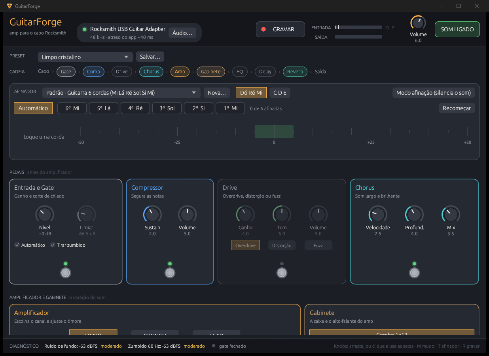

# GuitarForge

Amp de guitarra para Windows feito para o cabo Rocksmith USB (qualquer entrada de áudio também serve).
Funciona offline, sem conta e é código aberto.



## O que tem

- Acha o cabo Rocksmith sozinho e toca pela saída padrão do Windows, reamostrando se as taxas forem diferentes.
- Afinador por corda, automático ou guiado: 26 afinações de fábrica (guitarra de 6, 7 e 8 cordas, baixo de 4, 5 e 6)
  e afinações suas, com notação Dó Ré Mi ou C D E.
- Gate com limiar automático, que acompanha o ruído do seu cabo, e filtro do zumbido da rede (50 ou 60 Hz,
  detectado sozinho).
- Compressor, drive (overdrive, distorção e fuzz) e chorus.
- Amplificador com canais Limpo, Crunch e Lead; gabinete interno ou IR em WAV.
- Equalizador de 5 faixas, delay e reverb.
- Gravador: salva o som processado e o sinal seco do cabo (DI) em WAV.
- Presets de fábrica e seus, que guardam também a afinação.
- Diagnóstico do ruído de fundo e do zumbido que chegam pelo cabo.
- Tudo ajustável pelo teclado: clique num knob e use as setas (Shift para ajuste fino).

## Como compilar

Precisa do Rust (rustup) e das ferramentas de build do Visual Studio com o Windows SDK, de onde vem o `rc.exe` que
embute o ícone no executável.

```
cargo run --release
```

O executável fica em `target\release\guitarforge.exe`. `cargo test` roda os testes de DSP, afinador, gate, motor de
áudio e interface.

## Atalhos

M liga e desliga o som, T entra no modo afinação, R grava.

## Diagnóstico

A build de desenvolvimento (`cargo run`) abre um console e traz algumas ferramentas:

- `--dispositivos`: lista as entradas e saídas de áudio com o formato de cada uma.
- `--analisar arquivo.wav [fmin] [Hz da corda]`: roda o afinador sobre uma gravação.
- `--espectro arquivo.wav inicio fim`: picos do espectro de 40 a 700 Hz no trecho.
- `--ruido arquivo.wav inicio fim`: ruído do trecho, cru e sem o zumbido da rede.

## Limitações

A latência do app fica perto de 40 ms, porque o modo compartilhado do Windows trabalha em blocos de 10 ms. O próximo
passo é o modo exclusivo do WASAPI. Arquitetura, decisões e próximas fases em [docs/DESENHO.md](docs/DESENHO.md).

## Aviso

Projeto independente, sem relação com a Ubisoft. Rocksmith é marca da Ubisoft. O GuitarForge não usa código, áudio
nem dados do jogo: só lê o cabo, que o Windows reconhece como um microfone USB comum.

## Licença

MIT. Veja [LICENSE](LICENSE).

## English

GuitarForge is a guitar amp for Windows built around the Rocksmith USB cable (any audio input works too). It runs
offline, needs no account and is open source. It has a per string tuner (guitar and bass, custom tunings), a noise
gate with automatic threshold and mains hum filter, compressor, drive, chorus, a three channel amp, built in cabinets
or WAV impulse responses, EQ, delay, reverb and a recorder that saves both the processed and the dry signal. The
interface is in Portuguese. Build with `cargo run --release` (Rust plus the Visual Studio Build Tools with the Windows
SDK). Not affiliated with Ubisoft. MIT license.
